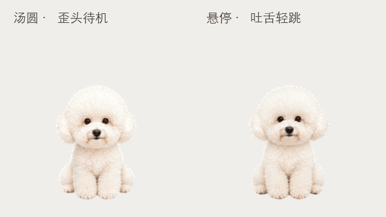

# 汤圆 · 白色比熊桌面宠物

纯白蓬松的小比熊，露出黑眼睛，不穿衣服、不戴项圈，没有泪痕。提供完整 v2 安装包、宠物配置和透明动画图集。



## 下载与安装

点击 [下载完整安装包](downloads/tangyuan-v2.codex-pet.zip)，在 GitHub 文件页面点击 **Download raw file** 保存 ZIP。

在支持本地自定义宠物的 Codex 桌面客户端中，将 ZIP 解压到 `~/.codex/pets/tangyuan/`。确保该目录直接包含 `pet.json` 和 `spritesheet.png`，然后在宠物选择器刷新并选择“汤圆”。若客户端版本不提供本地自定义宠物功能，请使用其支持的宠物导入方式。

macOS / Linux 终端解压示例（先切换到安装包所在目录）：

```sh
mkdir -p ~/.codex/pets/tangyuan
unzip tangyuan-v2.codex-pet.zip -d ~/.codex/pets/tangyuan
```

已有同名宠物时，请先备份旧目录。

## 动作

- 待机：蹲坐看向你，轻微呼吸、歪头和眨眼。
- 光标悬停：在支持悬停互动的客户端中，吐出小舌尖并开心轻跳。
- 其他状态：左右奔跑、招手、等待、工作、审阅、失败反应及 16 个看向方向。

动作触发由客户端控制；当前待机为固定循环，未实现真正的随机待机调度。悬停效果使用客户端的 jumping 动画状态。

## 文件

- `pet/pet.json`：宠物配置。
- `pet/spritesheet.png`：1536 × 2288 透明 PNG，8 列、11 行，每格 192 × 208。
- `downloads/tangyuan-v2.codex-pet.zip`：完整可安装资源包。
- `previews/`：互动、全部动作及图集预览。
- `SHA256SUMS`：安装包和源资源校验值。

这是由客户端加载的配置与动画资源包，不包含独立桌面应用程序。参考照片和制作过程中的临时文件不包含在此仓库。
